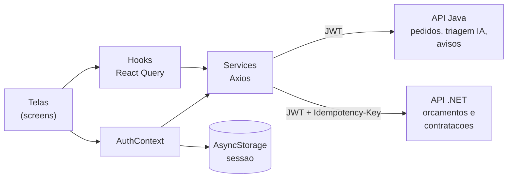

# Bico Certo Mobile

> **Global Solution 2026/2 · CitizenTech · Mobile Application Development (FIAP)**
> App em React Native (Expo) que conecta moradores a prestadores de serviço do próprio bairro, com **triagem inteligente do problema** e **preço justo**.

| | |
|---|---|
| **Vídeo (até 5 min)** | `LINK_DO_VIDEO` |
| **Publicação (Firebase App Distribution)** | `LINK_DO_FIREBASE` |
| **API Java (usuários, pedidos e triagem com IA)** | https://github.com/kaiky06301/bico-certo-java |
| **API .NET (orçamentos e contratações)** | `LINK_DO_REPOSITORIO_DOTNET` |

---

## O problema e a solução

Quem precisa de um eletricista, encanador ou diarista na periferia depende de indicação e **não sabe quanto é justo pagar**. O prestador bom do bairro, por sua vez, não consegue clientes fora do seu círculo.

No **Bico Certo**:
1. O morador descreve o problema com as próprias palavras.
2. O app mostra o que a **análise do Bico Certo** entendeu: tipo de serviço, urgência, **faixa de preço de referência** e uma dica de segurança para seguir enquanto espera.
3. Os prestadores daquela área recebem um aviso e enviam **orçamentos**.
4. O pedido pode ser feito em **qualquer endereço salvo** (casa, casa dos pais, trabalho). Antes da contratação os prestadores veem só o bairro; a rua aparece para o prestador escolhido quando o morador aceita o orçamento.
5. Morador e prestador podem **negociar o valor**: qualquer um propõe outro preço com um comentário, e o outro aceita, recusa ou faz uma contraproposta. Se ninguém aceitar, vale o valor atual.
6. A faixa de referência **não é um teto**: um serviço pode ter particularidades que justifiquem um valor maior. Mas, acima da faixa, quem propõe **precisa explicar o motivo**, e o morador vê o aviso "acima da faixa de referência" junto com a explicação.
7. O morador escolhe um orçamento, agenda a data e, no fim, **avalia** o prestador.

---

## Telas

| # | Tela | Perfil | O que faz |
|---|---|---|---|
| 1 | **Login** | público | Autenticação real com JWT na API Java |
| 2 | **Cadastro** | público | Cria conta de cliente ou de prestador (com o serviço que oferece) |
| 3 | **Novo pedido** | cliente | Descreve o problema, anexa até **3 fotos** (câmera ou galeria), informação adicional opcional e **onde será o serviço** → tela **"Confira a análise"** da IA → publica o pedido |
| 4 | **Meus pedidos** | cliente | Filtro por situação (abertos, em andamento, concluídos, cancelados) e o **próximo passo** em cada cartão ("3 orçamentos recebidos", prestador e data, "Avalie o prestador") |
| 5 | **Detalhe do pedido** | cliente | Mesma estrutura, conteúdo conforme a etapa: **orçamentos recebidos** → **prestador contratado** (valor, data, endereço e telefone) → **valor final e avaliação** → **motivo do cancelamento**. Fotos, análise da IA e **histórico do pedido** em linha do tempo |
| 6 | **Proposta** | cliente | Perfil e avaliações do prestador, valor, prazo, o que está incluso, **negociação** (contraproposta), **aceitar e agendar** ou **recusar** |
| 7 | **Editar pedido** | cliente | Corrige a descrição; a análise é refeita |
| 8 | **Oportunidades** | prestador | Pedidos da sua categoria que ele **ainda não orçou**, com selo "Novo pedido", **distância aproximada** do bairro dele, quantidade de **fotos** e faixa de referência. Botão **Filtros** (urgência; ordenar por mais recentes, mais próximos ou mais urgentes). Atualiza sozinha a cada 30 s |
| 9 | **Meus orçamentos** | prestador | Tudo o que ele já orçou, com a situação: orçamento enviado, em negociação, **responder proposta**, contratado, contratado outro prestador, recusado. Filtros e aviso de quantos clientes esperam resposta |
| 10 | **Detalhe do serviço** | prestador | Situação do ponto de vista do prestador, bairro e distância, data, fotos e análise da IA; botão **Enviar orçamento** no topo e atalhos de preço (mínimo, meio e máximo da faixa); informa **o que está incluso** (mão de obra, material, deslocamento, adicionais) e a **validade** da proposta; **negocia o valor** com histórico em linha do tempo e justificativa; pode **desistir do orçamento**; inicia e conclui o serviço. Rua e telefone só depois da contratação |
| 11 | **Agenda** | prestador | **Semana no topo** (quantos serviços em cada dia ou "livre"), filtros (próximos, hoje, amanhã, esta semana, concluídos, cancelados) e serviços **agrupados por dia** (Hoje, Amanhã…). Cada card: horário, status, serviço, valor, cliente e bairro/endereço, com **Iniciar/Concluir**, **Reagendar** e **Cancelar**; o endereço completo e o telefone podem ser copiados (toque longo). A API não deixa dois serviços a menos de 2 h |
| 12 | **Avisos** | ambos | Central de acompanhamento: filtros **Todas / Não lidas / Lidas**, ícone e título por **tipo** (orçamento, negociação, contratação, serviço, conclusão, cancelamento), valor e **atalho** ("Ver orçamento →" abre a proposta). Não lidos com fundo laranja e selo "Novo"; ao tocar, vira lido. Menu ⋯: marcar todas como lidas e limpar lidas; segurar exclui um aviso |
| 13 | **Perfil** | ambos | Cabeçalho com avatar, papel, nota e selo de verificado; seções **Minha conta**, **Perfil profissional** (prestador) e **Configurações** (notificações, termos, privacidade, excluir conta) e logout |
| 14 | **Dados pessoais** | ambos | Edita nome, telefone e bairro |
| 15 | **Alterar senha** | ambos | Troca a senha exigindo a atual, com confirmação |
| 16 | **Perfil do prestador** | ambos | Perfil público: foto, serviços, anos de experiência, especialidades, diferenciais, região, dias e horários, selos de **verificado** e **atende emergências**, galeria de trabalhos realizados (toque abre em tela cheia), nota e avaliações recebidas. O cliente abre pelo orçamento **antes de contratar** e o prestador abre em "Ver como o cliente vê" |
| 17 | **Perfil profissional** | prestador | Foto de perfil (câmera/galeria), nota e serviços feitos, quantos serviços quiser (o primeiro é o principal), tempo de experiência, especialidades e diferenciais com contador, bairros atendidos por lista, dias da semana com atalhos, horário de início e término, selo de emergências, galeria de até 6 trabalhos realizados e aviso de alterações não salvas |
| 18 | **Minhas avaliações** | cliente | Avaliações que o cliente fez |
| 19 | **Excluir conta** | ambos | Exclusão com senha e confirmação (LGPD: dados pessoais apagados) |
| 20 | **Termos e Privacidade** | ambos | Termos de uso e política de privacidade |
| 21 | **Meus endereços** | ambos | Lista de endereços (casa, casa dos pais, trabalho...): adicionar, editar, **excluir** e marcar o principal |
| 22 | **Novo / Editar endereço** | ambos | Nome do endereço, rua e número, complemento, bairro, cidade e UF |
| + | **Sobre o App** | ambos | Versão e **hash do commit** de referência (não conta para o mínimo de 6 telas) |

---

## Requisitos atendidos

| Requisito | Como foi feito |
|---|---|
| **1. Mínimo de 6 telas + navegação** | 22 telas + Sobre, com **React Navigation**: pilha de autenticação e, depois do login, abas e pilha diferentes para cliente e prestador (`src/navigation`) |
| **2. CRUD com a API (Axios)** | **Pedidos (API Java):** criar (`POST`), listar e detalhar (`GET`), editar (`PUT`) e cancelar (`DELETE`). Também orçamentos e contratações na API .NET. Loaders, mensagens de erro, "tentar de novo" e puxar para atualizar em todas as listas |
| **3. Autenticação** | Cadastro e login reais na API Java (JWT), **sessão persistida** (AsyncStorage) com expiração, **logout** que limpa a sessão e o cache, e **rotas protegidas** (sem login só existem Login e Cadastro). Token expirado (401) encerra a sessão automaticamente |
| **4. Estilização** | Identidade própria: paleta laranja e azul-marinho (`src/theme/cores.ts`), fonte **Poppins**, logo, ícone e splash próprios (`assets/`), ícones Ionicons, componentes com área de toque ≥ 48 px e rótulos de acessibilidade |
| **5. Arquitetura** | Camadas separadas por responsabilidade (abaixo), TypeScript, **ESLint + Prettier** (`npm run lint`, `npm run format`) |
| **6. Vídeo** | `LINK_DO_VIDEO` |
| **7. Publicação** | Firebase App Distribution, com o professor como testador; tela **Sobre o App** com o hash do commit (`app.config.js`) |

---

## Arquitetura

```
src/
├── config/        endereços das APIs (variáveis de ambiente / IP do Metro em desenvolvimento)
├── models/        tipos TypeScript dos dados das APIs
├── services/      acesso às APIs com Axios (httpClient com token e tratamento de 401) + AsyncStorage
├── hooks/         consultas com React Query (cache, atualização e chaves)
├── contexts/      AuthContext: sessão, login, cadastro e logout (Context API)
├── validation/    esquemas de validação dos formulários com Yup
├── navigation/    pilhas e abas por perfil (rotas protegidas)
├── screens/       telas separadas em auth/, cliente/, prestador/ e comum/
├── components/    componentes visuais reutilizáveis (Botao, CampoTexto, Cartao, Selo...)
├── theme/         cores, fontes, tamanhos e espaçamentos
└── utils/         formatação (moeda, data), mensagens de erro e agenda
```



**Decisões técnicas:**
- **Axios com interceptadores:** o token entra em todas as requisições e o 401 encerra a sessão num único lugar.
- **React Query:** cache, recarregamento e estados de carregando e erro sem repetir código em cada tela.
- **Idempotency-Key:** ao aceitar um orçamento ou enviar uma proposta, o app gera uma chave única e a reutiliza se o usuário tocar duas vezes ou a internet falhar. Assim a API .NET **não duplica a contratação**.
- **Negociação reaproveitada:** o componente `Negociacao` é o mesmo nas telas do cliente e do prestador; muda só quem está do outro lado.
- **Mesmo login nas duas APIs:** o JWT emitido pela API Java também é aceito pela API .NET.

---

## Tecnologias

| Biblioteca | Para quê |
|---|---|
| Expo SDK 58 + React Native + TypeScript | Base do app |
| `@react-navigation/native-stack` e `bottom-tabs` | Navegação |
| `axios` | Requisições HTTP às APIs |
| `@tanstack/react-query` | Cache e estado das requisições |
| `@react-native-async-storage/async-storage` | Persistir a sessão |
| `yup` | Validação dos formulários |
| `expo-font` + `@expo-google-fonts/poppins` | Fonte da identidade visual |
| `expo-constants` | Ler a versão e o hash do commit (tela Sobre) |
| `expo-splash-screen` | Tela de abertura com a marca, configurada no `app.json` |
| ESLint (`eslint-config-expo`) + Prettier | Padronização do código |

---

## Como rodar

**Pré-requisitos:** Node 20+, o app **Expo Go** no celular (mesma rede Wi-Fi do computador) e as duas APIs rodando.

```bash
# 1. APIs (em outros terminais) - veja o README de cada uma
#    API Java na porta 8080 e API .NET na porta 5090

# 2. App
git clone LINK_DO_REPOSITORIO
cd bico-certo-mobile
npm install
npx expo start
```

Leia o QR Code com o Expo Go. Em desenvolvimento, o app usa automaticamente o IP do computador que está rodando o Metro para chegar às APIs. Para apontar para APIs publicadas, defina `EXPO_PUBLIC_JAVA_API_URL` e `EXPO_PUBLIC_NET_API_URL`.

**Usuários de teste** (senha `senha123`):

| Perfil | E-mail |
|---|---|
| Cliente | `maria@bicocerto.com.br` |
| Prestador (elétrica) | `joao@bicocerto.com.br` |
| Prestador (encanamento) | `carlos@bicocerto.com.br` |

**Qualidade do código:**
```bash
npm run lint        # ESLint
npm run typecheck   # TypeScript
npm run format      # Prettier
```

---

## Integrantes

**Grupo:** Bico Certo Labs

| Nome | RM | Turma |
|---|---|---|
| Erick Bernardes Bradaschia | RM565733 | 2TDSR |
| Gabriel Santos Claudino | RM564054 | 2TDSR |
| Kaiky de Oliveira Silva | RM566067 | 2TDSR |
| Lucas Fortes de Lima | RM559523 | 2TDSR |
| Jonathan Moreira Gomes | RM565060 | 2TDSR |
